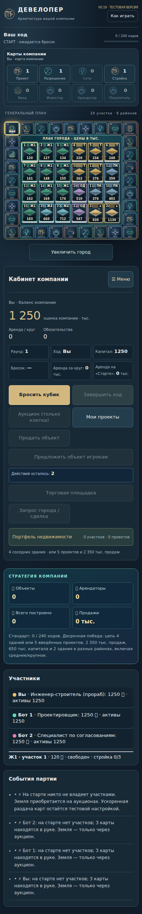
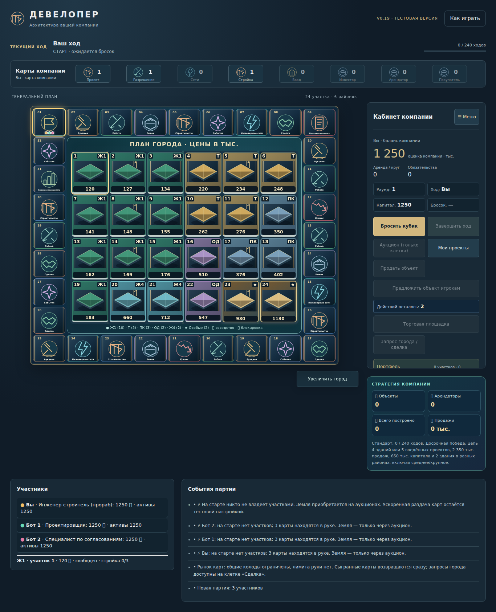
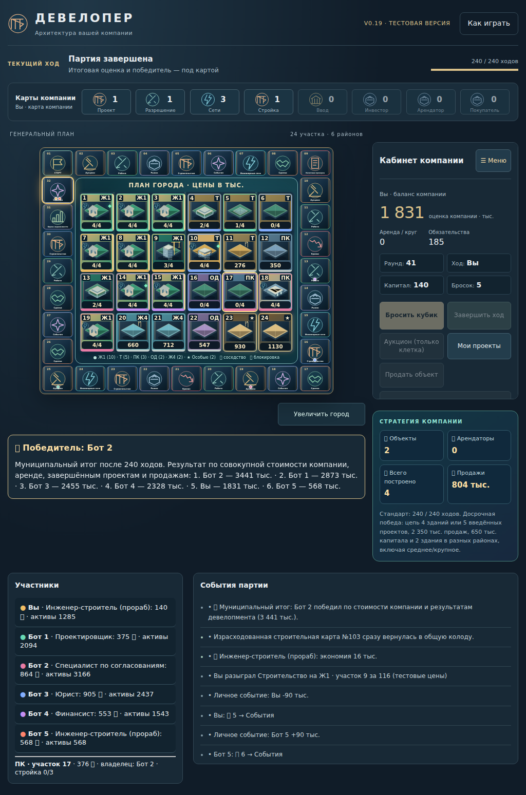

# WORK · v0.19 · отчёт контрольной сборки

Статус: полноценная локальная игра для пользовательского тестирования; **не стабильный релиз**. Ветка `work/rebuild-v019`, PR #18. Основа — main c86df7d с интегрированными PR #11/#14/#15, не старая HTML-копия. Реестр функций и проверок: `game/feature-contract.json`.

## Реализовано

1. Десять модулей исходного ядра, явный порядок загрузки и отдельный AI с внедрением зависимостей. 108 исходных функций перенесены без изменения тел на этапе извлечения (поимённые SHA256 в CORE_EXTRACTION_PROOF.json). Последующая переработка хранения описана отдельно.
2. Неизменяемая проекция `DeveloperGame` для интерфейса, список допустимых команд, ограниченная диагностика. Результат игрового действия не ждёт анимации или звука. Старые глобальные точки входа оставлены для совместимости существующих диалогов.
3. Единый интерфейс: состояние хода, подписанные колоды, оценка компании, обязательства, аренда, портфель с открытием реального паспорта, руководство, журнал. Адаптация смартфон/планшет/компьютер и клавиатурный фокус. Карта и паспорт сохраняют ресурсы SVG v1.
4. Отдельное сохранение v0.19, восстановление после установки всех модулей, перенос JSON, явный импорт v0.18 и отказ от повреждённых файлов до замены слота. Импорт ограничен простыми данными игры без HTML/атрибутной разметки и чрезмерной вложенности.
5. Исправлены дублирующее окно при восстановлении налоговой проверки и оставшиеся от прежней партии окна. Целевой Chromium-тест сначала воспроизвёл сбой, затем проверил единственное списание, восстановление аукциона, карты события и выбора колоды. Также исправлены неточное описание закрытого аукциона, устаревшее сообщение о неактивных профессиях, английские названия колод в уведомлениях и выход денежной анимации за границу показателя.
6. Воспроизводимая сборка с SHA256 всех файлов. Pages сохраняет прежние stable/rc1 и добавляет изолированный путь v0.19 после интеграции. До интеграции используется отдельный тестовый адрес Sites.

## Сохранённые механики

24 участка и 32 клетки; 3–6 участников; 2d6 и два действия; покупка земли на закрытых аукционах; размеры и парные участки; проектирование/разрешения/строительство/ввод; сети; арендаторы и выплата на «Старте»; инвесторы, расчёт долей и обслуживание оставшегося кредита; продажа фонду/по карте/между игроками; рынок, сделки, обмен земли на карты; профессии; конечные физические колоды с возвратом карт и без лимита руки; городские заявки; боты; аудит и события; территориальная победа, стратегия девелопера и тендер на 240 ходов; локальное сохранение и восстановление. Новые условия выдачи кредитов или фундаментальные правила не вводились.

## Выполненные проверки

- Node: feature-contract, architecture, smoke, territory, city-requests, pace, rework, tournament-v016, svg-assets, finance-integrity и build-package — пройдены. Старые smoke/pace проверяют промежуточные слои без окончательных расширений; их длинные партии не заменяют полный турнир v0.19.
- 1000 партий main и 1000 партий после выделения модулей: записи побайтно одинаковы. Хеш и таблица в REPLAY_PARITY.json / QA_ANALYSIS.json. Дополнительно 1000 партий после UI/storage (ff78e99) снова совпали побайтно; последняя сборка 3999780 проверена 16 такими же партиями после исправления восстановления модальных решений. SHA и границы прогонов честно указаны в FINAL_QA.json.
- Chromium: marketplace, city_requests, visual, territory, finance, living_city, work_integration, rc1_stability, studio, storage_v019 и pending_restore — пройдены. Проверены размеры 390×844, 768×1024, 1024×768, 1366×900/1000 и 844×390; сенсорный ввод проверен в сценариях карты/зумирования.
- Две реальные браузерные партии (3 и 6 участников) завершены на 240 ходах с промежуточным восстановлением. Построено соответственно 16 и 15 проектов. После конца проверены неизменность партии и отсутствие оставшейся движущейся фишки. Финансы конечны, JS-ошибок нет, DOM 990/972 узла, 24 участка и 32 клетки.
- 266 SVG проверены; отсутствующие манифест и отдельные SVG оставляют рабочий HTML-резерв. Проверены идемпотентная отрисовка, отсутствие дублей арта и перекрытий метаданных, удаление сетевых маркеров, звук и reduced motion.
- Оценка render в серии living_city: примерно 30–63 мс на проход на этом стенде. Это стоимость полной перерисовки, не частота кадров реального Android. Дальнейшее сокращение DOM-перерисовок остаётся задачей.
- Резервная копия действительно скачана и загружена через браузерный файловый ввод. Неверный JSON/разметка не заменяют слот; stable-слот остаётся прежним. Запрет localStorage не блокирует новую партию.

## QA экономики

805/1000 тендеров воспроизведены: 58,8% при 3 участниках против 92% при 6. Другие исходы: территория 16,6%, девелопер 2,9%. Экономика развивается, но в конечных позициях чаще всего не достигнут порог продаж; недостающие карты руки и неподготовленные цепи также часты. Это корреляции, не причинное доказательство. Полные цифры, ограничения и задание QA — QA_RESEARCH.md. Баланс не менялся. Длительность 1–3 часа остаётся неподтверждённой без человеческих сессий.

## Оценка качества (инженерная самооценка, не пользовательский рейтинг)

| Область | 0–10 | Основание |
|---|---:|---|
| Сохранение правил | 9 | Контракт, идентичные seeded-партии, финансовые тесты |
| Полный цикл / боты | 8 | VM и браузерное завершение; одинаковая стратегия AI |
| Архитектура | 7 | Модули и явная граница UI; остаются legacy globals и цепочки override |
| Интерфейс | 7 | Единая система, портфель, финансовый обзор; компактная карта требует zoom |
| Мобильное управление | 7 | Chromium/touch/landscape; физический Android ещё не проверен |
| Сохранения | 8 | Изоляция версий, проверка и перенос; без облачного хранения |
| Графика / анимация | 8 | 266 ресурсов, fallback и независимость от логики; SVG v2 отложена |
| Доступность | 6 | Фокус, подписи и reduced motion; часть старых диалогов без единого focus manager |
| Производительность | 7 | Ограниченные DOM и журнал; полная перерисовка ещё дорога |
| Доказанность баланса | 5 | Есть повторяемые данные; нет человеческих замеров и причинных экспериментов |

## Оставшиеся проблемы и следующий этап

- Провести реальную Android QA на 360–430px, планшете и горизонтальном экране: покупка → все этапы → инвестор/аренда/продажа → JSON на другое устройство → победа. Записать модель, браузер, масштаб шрифта и активное время.
- QA: исследование стратегий, условий победы и длительности по QA_RESEARCH.md. Не менять баланс в технической ветке.
- Programm: проверить PR #18 и CI, затем интегрировать обычным PR. Сначала принять архитектурный контракт и регрессии; после слияния проверить изолированную Pages-сборку. Main и прежняя стабильная сборка в этой работе не менялись.
- Следующая инженерная итерация: перевести финансовые/торговые расширения с цепочек override на команды с явными зависимостями; сократить полную перерисовку до изменившихся участков; объединить focus management всех старых модальных окон и проверить screen reader. Сохранять текущие seeded-записи как контроль экономики.
- Сеть и мультиплеер отсутствуют и не заявлены готовыми. SVG-библиотека v2 не разработана по решению владельца. Это не финальная коммерческая сертификация.

Скриншоты в `docs/v019/screenshots/`: стартовые интерфейсы — обычная новая партия; finished — реальные автоматические браузерные партии с ускоренными таймерами. Они не являются подтверждением физического Android-тестирования.

## Адрес, SHA и этапы

[Играть в v0.19](https://developer-v019.jazzywren11.chatgpt.site) — приватный адрес владельца. Публикация подтверждена Sites (`succeeded`), 299 файлов сопоставлены с манифестом. SHA кода игры: `399978098931c701798ebf5b30f68e15fbf21cd6`. Полная квитанция — DEPLOYMENT.json. Проверки хостинга в управляемом браузере не выполнялись: сборка проверена локальным Chromium, онлайн-развёртывание — штатным ответом сервиса.

| Этап | Коммит |
|---|---|
| Реестр и архитектура | [3abd38a](https://github.com/bunkovde-lab/developer-web/commit/3abd38abd9839cd63584f8a96142417342036c35) |
| Ядро и AI | [97288ec](https://github.com/bunkovde-lab/developer-web/commit/97288ecf322730c13070497cfea3101dcf1d944e) |
| Единый интерфейс | [618e3a8](https://github.com/bunkovde-lab/developer-web/commit/618e3a8a05c2a4d9b98a6e472088f33a80972f8e) |
| Сохранения и презентация | [ff78e99](https://github.com/bunkovde-lab/developer-web/commit/ff78e994e89ac5bb146312f609cd013c27621b83) |
| Проверки и QA | [25ad060](https://github.com/bunkovde-lab/developer-web/commit/25ad06099c2aa9d3079d684f2f7086745b1d56ec) |
| Контрольная сборка | [ccf7907](https://github.com/bunkovde-lab/developer-web/commit/ccf7907ff842fc14d95bebf41140bddcc8321600) |

Последующее исправление сохранений: [3999780](https://github.com/bunkovde-lab/developer-web/commit/399978098931c701798ebf5b30f68e15fbf21cd6). Этот SHA опубликован по тестовому адресу; исходы и финансовые записи 16 контрольных партий совпадают с эталоном.

После финального исправления 3999780 обе полные браузерные партии повторены успешно: 3/6 участников, 240 ходов, восстановление и отсутствие изменений после завершения. Для этого SHA CI браузера и упаковки успешен; Node CI продолжал серию 1000 на момент передачи, предыдущий ccf7907 имеет все три успешных workflow. Локальные соответствующие проверки завершены.
